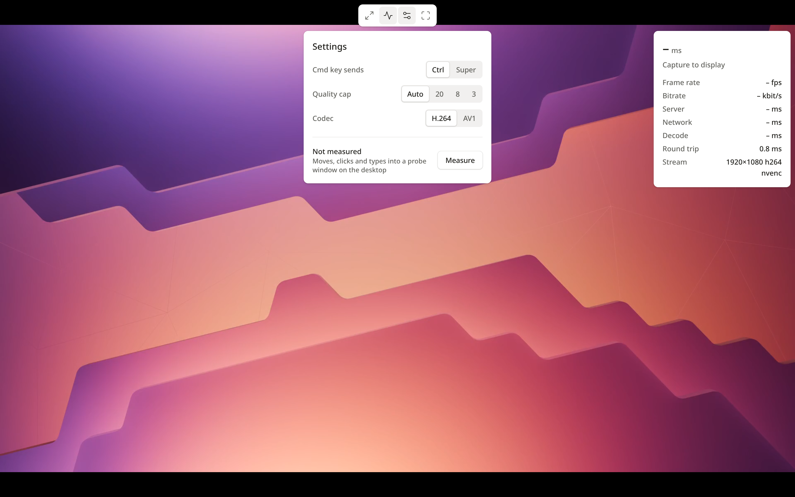
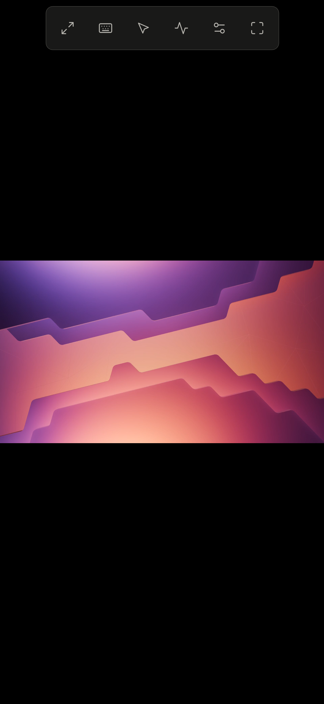
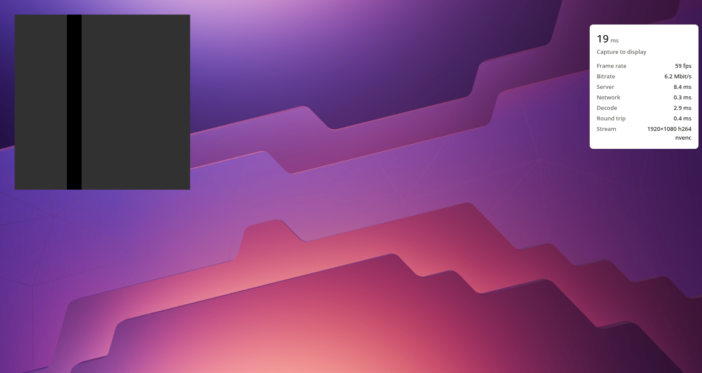
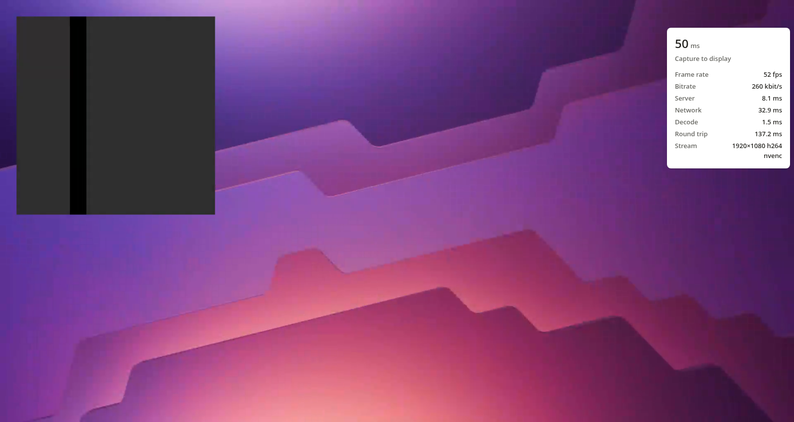

# Skylight

A remote desktop for Linux that runs in the browser, built around one number: the time from a
click or key press on your laptop or phone to the changed pixels on your screen.

It captures the desktop through KWin's screencast (Wayland) or MIT-SHM (X11), encodes only what
changed with NVENC (x264 when there is no GPU), sends it over a WebSocket, and decodes it with
WebCodecs straight onto a canvas. Input travels on its own socket and is injected the instant it
arrives. The cursor is drawn by the browser, so it never lags.



## Features

- **Low latency:** about 25 ms from click to screen over loopback and under 100 ms through a
  public TCP tunnel, at 57-59 fps under motion (measured below).
- **Runs in any modern browser.** No plugin or app. Hardware decoding wherever the browser has it
  (WebCodecs, H.264 by default, HEVC and AV1 when both ends support them).
- **KDE Plasma on Wayland** (KWin screencast, fake input, clipboard) and **X11** (MIT-SHM, XDamage,
  XTEST).
- **NVENC, VAAPI or software encoding** (x264, x265, SVT-AV1), with damage tracking: an idle
  screen sends nothing.
- **Built for Mac and iPhone clients:** keys by physical position, Cmd mapped to Ctrl, clipboard
  both ways, trackpad-style touch control and the iOS keyboard.
- **No passwords.** Access is a short-lived Ed25519-signed ticket minted by an app you control.
  Skylight only listens on loopback and holds only public keys.
- **Embeddable:** `web/skylight.js` is one dependency-free ES module you can drop into your own
  web app ([INTEGRATION.md](INTEGRATION.md)).
- **Small:** one 4.7 MB binary, about 55 MB of memory idle.

## Requirements

- Linux with **KDE Plasma 6 on Wayland**, or any **X11** session. GNOME and wlroots Wayland
  sessions are not supported yet (they need the xdg-desktop-portal path).
- PipeWire and FFmpeg's libraries (libavcodec, libavutil, libswscale).
- For hardware encoding: an NVIDIA GPU with NVENC, or (untested) a VAAPI-capable Intel or AMD GPU.
  Without one, x264 keeps up on a modern CPU.
- To build: Rust 1.88 or newer, clang and pkg-config.
- A browser with WebCodecs on an HTTPS page (or localhost): current Chrome, Edge, Safari and
  Firefox.

## Install

Debian 13 / Ubuntu packages:

```sh
sudo apt install libpipewire-0.3-dev libspa-0.2-dev libavcodec-dev libavutil-dev \
  libswscale-dev plasma-wayland-protocols clang pkg-config
```

Build and install:

```sh
cargo build --release
install -Dm755 target/release/skylight ~/.local/bin/skylight

# Let KWin trust this binary for screencast and input (writes a .desktop file), and install
# a systemd user service.
~/.local/bin/skylight install --service

# A ticket key pair. Whatever mints tickets keeps the private key; Skylight only needs the
# public one.
skylight keygen --out-dir ~/.config/skylight

cat > ~/.config/skylight/env <<EOF
SKYLIGHT_TICKET_KEY=$HOME/.config/skylight/ticket-public.txt
SKYLIGHT_AUDIENCE=my-desktop
SKYLIGHT_PROBE_DISPLAY=:1
EOF
chmod 600 ~/.config/skylight/env
systemctl --user enable --now skylight

skylight doctor     # backend, monitors, encoders, a test capture
```

`SKYLIGHT_PROBE_DISPLAY` is the X display the latency probe opens on: Xwayland's display on KDE
(usually `:0` or `:1`, see `echo $DISPLAY` in a terminal on the desktop).

## Run

To open the built-in viewer on the machine itself, mint a one-time link (the ticket rides in the
URL fragment, which browsers never send to a server; the page removes it at once):

```sh
skylight ticket --key ~/.config/skylight/ticket-private.pem --audience my-desktop \
  --url http://127.0.0.1:5490/
```

To reach it from other devices, put a TLS-terminating reverse proxy (or a private network) in
front of `127.0.0.1:5490`, and have your own web app mint tickets for signed-in users. Both are
described in [INTEGRATION.md](INTEGRATION.md), with a Caddy example. For a quick test from
another device you can also mint a link with `--url https://desk.example.com/` once the proxy is
up.

To turn it off: `systemctl --user disable --now skylight`.

## Configure

`skylight serve` reads these from the environment (the service loads `~/.config/skylight/env`)
or from the matching flags (`skylight serve --help`):

| Variable / flag | Default | |
|---|---|---|
| `SKYLIGHT_TICKET_KEY` / `--ticket-key` | required | trusted ticket public keys, comma-separated: files (raw base64url or SPKI PEM) or base64url keys |
| `SKYLIGHT_AUDIENCE` / `--audience` | the hostname | this server's name; tickets must carry it as `aud` |
| `SKYLIGHT_ALLOW_ORIGINS` / `--allow-origin` | none | browser origins allowed to open the WebSockets, besides the built-in viewer |
| `SKYLIGHT_LISTEN` / `--listen` | `127.0.0.1:5490` | loopback address to listen on; anything else is refused |
| `SKYLIGHT_BACKEND` / `--backend` | `auto` | `kde`, `x11` or `synthetic`; `auto` picks KWin, then X11 |
| `SKYLIGHT_PROBE_DISPLAY` / `--probe-display` | `$DISPLAY` | X display for the latency probe window |
| `--encoder` | `auto` | `nvenc`, `vaapi` or `software` |
| `--max-fps` | 144 | frame-rate cap; clients may ask for less |
| `--max-mbps` / `--start-mbps` | 50 / 16 | bitrate cap and starting point; the controller adapts in between |
| `--max-sessions` | 4 | concurrent viewers |
| `--web-dir` | built in | serve the web client from a directory instead (for development) |

### Backends

| | Capture | Input | Clipboard |
|---|---|---|---|
| `kde` (KWin, Wayland) | `zkde_screencast_unstable_v1` → PipeWire memfd, damage and cursor metadata | `org_kde_kwin_fake_input` | `wlr-data-control` |
| `x11` | MIT-SHM, driven by XDamage; cursor from XFixes | XTEST | not yet |
| `synthetic` | moving test pattern | none | none (used by `bench` and tests) |

Encoders: NVENC (H.264, HEVC, AV1), VAAPI (written, not yet tested on hardware), and x264, x265
or SVT-AV1 in software. The browser says which codecs it can decode, and H.264 is the default.

### Staying up

Skylight watches its own picture and repairs it instead of streaming black:

- **Capture.** Every session's encoder thread checks its capture four times a second. The capture
  is reopened when the source closes or fails (KWin closed the screencast, the PipeWire node went
  away), when it delivers no first frame within 3 s, when the picture has been black for 3 s, when
  the pointer moved and the compositor sent nothing back for 2.5 s, or when the monitor changed
  size or went away. On KWin a reopen alternates between the output stream and a region stream
  over the same monitor, two separate paths through the compositor. Reopens back off (3 s, 10 s,
  30 s, up to 5 min) so a desktop that really is black costs almost nothing. After three failed
  reopens in a row the session ends with an error, so the client reconnects or the host page falls
  back. If the compositor connection itself drops, the server exits and the service restarts it.
- **Encoder.** An encoder that fails twice in a row is skipped for a minute in favour of the next
  one (NVENC, VAAPI, software). The first keyframe from each encoder, then one every 30 s, is
  decoded on the server and compared with the captured picture; an encoder that sends black is
  skipped the same way.
- **Decoder.** H.264 parameter sets always declare that frames are never reordered, so browsers
  that follow the DPB rules strictly (Chromium's hardware decoders among them) show each frame at
  once instead of after up to 16 more. The client also flushes a decoder that holds frames and
  switches to software decoding if the picture stays stuck or black (`health` events, see
  [INTEGRATION.md](INTEGRATION.md)).
- **`/healthz`** returns JSON: `status` (`ok` or `degraded`), each running capture (size, frames,
  ms since the source last sent anything, black or not, error) and the last recoveries.

## Using it

- **Mac keyboard.** Keys go by physical position (`KeyboardEvent.code` to evdev). Cmd sends Ctrl
  by default, so Cmd+C, Cmd+V and Cmd+Z do what a Mac user expects; Settings switches it to
  Super. macOS never reports key-ups while Cmd is held, so those keys are released at once.
  In full screen, Chrome's Keyboard Lock passes through Esc and Cmd+W.
- **Clipboard.** Cmd+V first sends your clipboard (from the browser's paste event, no permission
  prompt) and then the paste. Copying on the remote desktop fills your clipboard, through a
  promise handed to the clipboard during the key press so Safari allows it.
- **Phones.** Trackpad mode by default: drag to move the pointer, tap to click, two-finger tap
  to right-click, two-finger drag to scroll, tap then drag to drag, and pinch to zoom the view.
  Direct mode taps where you touch. The keyboard button brings up the on-screen keyboard; typed
  text goes through as key presses (US layout).
- **Displays.** Each monitor is offered by connector name. With more than one, there is also an
  "All" stream of the whole desktop.
- **Latency test.** Settings → Measure runs the click, key and move probes from whatever device
  you are on and shows the medians.



## Benchmarks

Measured on a Linux desktop: KDE Plasma 6 on Wayland, one 1920×1080 monitor at 144 Hz, an NVIDIA
GPU with NVENC. The browser is headless Chromium on the same machine: software H.264 decoding and
a 60 Hz page. A client with hardware decoding and a 120 Hz screen should come in somewhat lower.
"Public" goes out through a public TCP tunnel's relay and back to a reverse proxy on the same
machine, so the relay is crossed twice. Every figure comes from `scripts/final-bench.sh` (raw
output in [`docs/results/`](docs/results)), 50 samples per input type.

### Input to photon

| Path | Click to update | Key press to glyph | Pointer move to hover change |
|---|---|---|---|
| Local (loopback) | **25.4 ms** (p95 35.7) | **29.5 ms** (p95 41.2) | 33.0 ms (p95 45.0) |
| Public TCP tunnel (47 ms round trip) | **97.2 ms** (p95 115.2) | **80.5 ms** (p95 99.6) | 76.5 ms (p95 88.9) |
| X11 backend on Xvfb, local (30 samples) | 21.7 ms (p95 30.8) | 23.8 ms (p95 37.2) | 18.5 ms (p95 31.8) |

These are medians from sending the input in the browser to the first display refresh that
shows the result. Xvfb has no compositor and no vblank to wait for, which is why X11 comes in
under KWin there. To the decoded frame (before waiting for the refresh) it is 18.3 ms for a
click and 20.5 ms for a key locally, and 85.5 ms and 71.8 ms through the tunnel. Almost all of
the tunnel's extra time is its relay, which nothing in Skylight can remove; over a direct
private network the local numbers apply.

How it is measured: Skylight opens a small probe window on the desktop. In `click` mode each
click flips it between white and black; in `key` mode each key press redraws it as a page of the
typed letter with an X core font, the way a terminal draws text; in `move` mode it turns white
or black depending on which half the pointer is over. The browser sends the input, then reads
the probe's pixels out of every decoded `VideoFrame` (`copyTo`, so the measurement does not
stall rendering) until the change shows up. That covers everything a person feels: input over
the network, injection into KWin, the app redrawing, compositing at 144 Hz, capture, encode, the
network again, decode and the next display refresh. It does not cover the monitor's own panel
latency, which no browser can see.

Where the local time goes (server-side timestamps, click and key):

| Stage | Median |
|---|---|
| Input arrives to frame captured (app redraw, Xwayland, KWin composite at 144 Hz, screencast) | 10.5 ms |
| Copy and NVENC encode | 3.7 ms |
| Network, decode, drawing (loopback) | about 4.5 ms |
| Waiting for the next 60 Hz refresh | about 7 ms |

KWin's part dominates. Skylight's own share is under 4 ms on the server.

### Motion, bandwidth, quality

With the probe animating continuously (`animate` mode, a 480×480 region redrawn as fast as X
takes it):

| | Local | Public TCP tunnel |
|---|---|---|
| Frame rate (page refresh is 60 Hz) | 59.4 fps | 56.9 fps |
| Bandwidth | 5.1 Mbit/s | 1.0 Mbit/s |
| Capture to display | 15.1 ms (p95 22.7) | 44.0 ms (p95 67.1) |
| of which server (capture to encode, encode) | 8.0 ms (5.3 + 2.7) | 7.9 ms (5.4 + 2.7) |
| network | 0.3 ms | 30.1 ms |
| decode | 1.8 ms | 1.1 ms |
| round trip | 0.5 ms | 47.2 ms |

The motion run, locally and through the tunnel (the probe is the animated square, the panel on
the right is the viewer's stats):





An idle desktop sends nothing at all: frames are produced only for damage, and only the changed
pixels are copied.

Encoder alone, 1080p, `skylight bench` ([`encode.txt`](docs/results/encode.txt)):

| Encoder | Mean | p95 | p99 |
|---|---|---|---|
| NVENC H.264, preset p2 | 3.29 ms | 3.56 ms | 3.72 ms |
| x264 superfast, sliced threads (software fallback) | 3.59 ms | 4.03 ms | 6.48 ms |

Both kept up with 144 fps of full-screen motion. On the real desktop at the 50 Mbit/s cap, a
still image decodes at 49.5 dB luma PSNR on the first frame and 50.9 dB after two refinement
frames (6 to 8 kB each). Those are re-encodes of the unchanged screen sent 120 ms after motion
stops, so text sharpens right after you stop scrolling.

### Footprint

| | |
|---|---|
| Release binary | 4.69 MB stripped (`strip = true`), plus system FFmpeg and PipeWire |
| Memory, idle | 55 MB RSS |
| Memory, one viewer streaming | 241 MB RSS median, 255 MB peak |

About 140 MB of the streaming figure is the NVIDIA driver's pinned memory for the CUDA context
and NVENC surfaces (`/dev/nvidiactl` and `/dev/zero` mappings). Skylight's own heap is about
40 MB: one frame store, one encoder input frame and the PipeWire buffers.

## What makes it fast

- **Separate input socket, no batching.** Every pointer move, click and key is one tiny binary
  message on `/input`, injected the moment it is read. `TCP_NODELAY` is on everywhere, and
  Chrome's `pointerrawupdate` is used where available.
- **Frames that answer input skip the queue.** For 250 ms after any input, a new frame is encoded
  the instant KWin delivers it, ignoring the frame-rate cap.
- **Zero-latency encoding.** No B-frames, no lookahead, no scene-cut keyframes, an infinite GOP
  (keyframes only on request), `tune=ull`, `zerolatency`, `delay=0`, and a VBV of 34 ms so no
  single frame can stall the link. Rate control is VBR capped at the target: a frame that
  changes a few pixels costs a few kilobytes, not a whole frame's budget.
- **Damage tracking end to end.** KWin's damage rectangles decide what gets copied, and an idle
  screen sends no frames.
- **Decode on arrival.** `VideoDecoder` with `optimizeForLatency`, drawn the moment it outputs.
  Each decoded frame is acknowledged.
- **Pacing that never builds a queue.** If the oldest unacknowledged frame is older than the best
  recent round trip plus a small allowance, the next frame is skipped before it is encoded (so
  no reference is lost). Over TCP, that is what keeps a slow link from buffering seconds of video.
- **Client-side cursor.** KWin hands the cursor over as metadata, never burned into the video.
  The browser shows it as a CSS cursor with the real shape, so pointer motion has no network
  latency at all. On a phone it is drawn as a sprite you steer like a trackpad.

FFmpeg's NVENC wrapper resets the encoder and sends a keyframe on every bitrate change (checked
by an ignored test, `cargo test -- --ignored`). So on NVENC the cap moves only on big, settled
changes, at most every 3 seconds; x264 reconfigures in place.

## Security and threat model

**What is at stake:** keyboard and mouse on a logged-in desktop session, which amounts to running
anything as that user, plus whatever is on screen and in the clipboard.

**Who might try:** anyone on the internet who finds the public URL; anyone on the LAN or the
private network; a web page open in the user's browser (cross-site WebSocket); someone watching
the network; a leaked ticket or a leaked Skylight config.

**What stops them:**

- **No open port.** Skylight refuses to bind anything but loopback (`127.0.0.1:5490` by default).
  It is reachable only through whatever you put in front of it: a reverse proxy, a tunnel to that
  proxy, or a private network.
- **Short-lived signed tickets, never passwords.** The format is
  `sk1.<base64url claims>.<Ed25519 signature>`, with claims `{v, aud, sub, iat, exp, jti, scope,
  mon?, ses?}`. Skylight verifies the signature against the public keys it trusts, requires its
  own `aud`, rejects anything that lives longer than 120 s or is expired or not yet valid (30 s
  skew), spends each `jti` once, and caps sessions at 24 h. Skylight holds only public keys, so
  its config cannot mint access.
- **Scopes are enforced on the server.** `view` is required. Without `input` there is no input
  socket and input messages are dropped; `clipboard` gates both directions. `mon` pins a ticket
  to one display.
- **Tickets stay out of logs.** A ticket travels in the first WebSocket message, never in a URL a
  proxy would log. The viewer's link carries it in the fragment and strips it on load.
- **Origin allowlist** on both WebSocket upgrades, against cross-site WebSocket hijacking.
- **Limits:** 5 s for an unauthenticated socket to present a ticket, at most 32 of those at once,
  4 sessions, 2 MB messages, 1 MB clipboard. Keys outside evdev 1-248 and the power and sleep
  keys are dropped. Every held key and button is released when a session ends.
- **TLS** ends at your reverse proxy (or the private network); a TCP tunnel's relay sees only
  ciphertext. The hop to Skylight is loopback.
- **Static pages** are `no-store` with a strict CSP (`default-src 'none'`, scripts and styles
  from self, `frame-ancestors 'none'`).
- **The service is sandboxed:** `ProtectSystem=strict`, `NoNewPrivileges`, write access only to
  the runtime directory.

**What it does not protect against:** a compromised host app holding the private key (it can
mint tickets; that is its job), anyone with a shell as the desktop user, or someone who can
replace `~/.local/bin/skylight` (KWin trusts that path through the `.desktop` file; anyone who
can write it already runs as that user). Bandwidth-exhaustion DoS through a tunnel is out of
scope. The latency probe opens a window on the desktop, and only for an `input` session.

## Benchmarks and tests

```sh
cargo test                       # unit tests (tickets, pacing, framing, damage, encoder)
cargo test -- --ignored          # also the NVENC keyframe-on-bitrate-change check (needs a GPU)
cargo clippy --all-targets
pnpm install && pnpm test        # ticket interop between the Node minter and the Rust verifier
skylight bench                   # encoder speed and still-image quality on this machine
node scripts/bench.mjs           # end to end in Chromium: latency, frame rate, bandwidth
node scripts/bench.mjs --base https://desk.example.com/   # the same through your public URL
./scripts/final-bench.sh         # all of the above plus server RSS, into docs/results/
                                 # (set SKYLIGHT_PUBLIC_URL to include the public run)
node scripts/screenshots.mjs     # the viewer screenshots in docs/results/
```

The browser scripts need Chromium at `/usr/bin/chromium` and the service's private key at
`~/.config/skylight/ticket-private.pem` (or `--key`); tickets use the hostname as `aud` unless
you pass `--aud`. [docs/PROTOCOL.md](docs/PROTOCOL.md) documents the wire format.

## Not done yet

- **Audio** is not implemented.
- **GNOME and wlroots sessions** need the xdg-desktop-portal backend.
- **X11 clipboard** sync is not implemented.
- **Safari, iPhone and macOS** have not been measured on real devices yet. The client sticks to
  APIs Safari supports (WebCodecs, ClipboardItem promises, pointer events), but "should work" is
  not "measured". Run the latency test from them.
- **Zero-copy capture.** Frames come over shared memory, so KWin reads them back from the GPU and
  Skylight uploads them again. DMA-BUF import into CUDA would save a few milliseconds of the 10.5
  ms KWin share and the copy.

## License

MIT, see [LICENSE](LICENSE). The Wayland protocol files in `protocols/` keep their own license
(LGPL-2.1-or-later), see [protocols/README.md](protocols/README.md).
