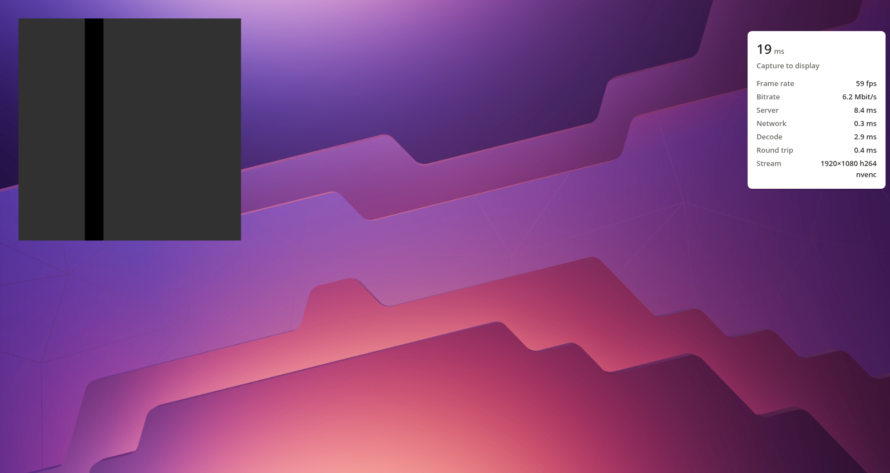
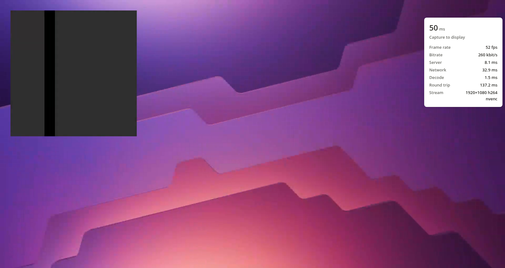

# Benchmarks

Measured on a Linux desktop: KDE Plasma 6 on Wayland, one 1920×1080 monitor at 144 Hz, an NVIDIA
GPU with NVENC. The browser is headless Chromium on the same machine: software H.264 decoding and
a 60 Hz page. A client with hardware decoding and a 120 Hz screen should come in somewhat lower.
"Public" goes out through a public TCP tunnel's relay and back to a reverse proxy on the same
machine, so the relay is crossed twice. Every figure comes from `scripts/final-bench.sh` (raw
output in [`results/`](results)), 50 samples per input type.

## Test bed: before and after the speed work

The numbers in this section come from a throwaway virtual X display (Xvfb, 1920×1080, X11
backend) with a second server on its own port, NVENC on an RTX-class GPU, and headless Chromium on
the same machine. Slower paths are emulated by `scripts/netem.mjs` (fixed delay, and a bottleneck
with a deep queue). Everything is reproducible with `scripts/testbed.sh` and
`scripts/link-bench.sh`. Medians of 50 samples per input type; "before" is the previous release
measured the same way, in the same session.

Input to decoded frame (ms), the browser's view of a click or key press on the remote desktop:

| Path | Input | Median | p95 | To display (median) |
|---|---|---|---|---|
| Loopback | click | 9.9 → **6.7** | 17.7 → 7.3 | 19.4 → 17.0 |
| | key | 11.9 → **6.9** | 23.6 → 8.0 | 20.6 → 14.3 |
| | move | 10.6 → **7.8** | 22.5 → 8.7 | 21.4 → 17.2 |
| 47 ms round trip | click | 59.4 → **55.7** | 68.9 → 56.6 | 69.0 → 62.7 |
| | key | 61.9 → **56.8** | 73.8 → 57.9 | 70.4 → 64.8 |
| 10 Mbit/s, 40 ms | click | 53.5 → **48.2** | 61.9 → 49.3 | 60.3 → 54.8 |
| | key | 55.2 → **49.2** | 69.0 → 50.1 | 63.6 → 57.0 |
| 5 Mbit/s, 60 ms | click | 73.3 → **68.2** | 80.8 → 69.5 | 84.3 → 77.2 |
| | key | 77.0 → **68.8** | 97.1 → 70.1 | 86.8 → 76.6 |

Glass to glass under motion: the animated probe stamps every redraw with the time, and the
browser reads it back out of each decoded frame, so this is the time from the app drawing a frame
to the browser having it, plus how many distinct frames arrive per second:

| Path | Content | Median (ms) | p95 (ms) | Distinct frames/s | Mbit/s |
|---|---|---|---|---|---|
| Loopback | animation | 11.4 → **6.8** | 21.4 → **9.1** | 58.2 → **59.6** | 1.7 → 1.2 |
| Loopback | scrolling text | 11.8 → **6.2** | 22.3 → **8.0** | 56.5 → **59.6** | 2.2 → 1.8 |
| 47 ms round trip | animation | 37.9 → **30.1** | 48.3 → **32.9** | 58.4 → **59.6** | 0.5 → 1.2 |
| 47 ms round trip | scrolling text | 34.0 → **31.2** | 47.0 → **33.6** | 56.1 → **59.7** | 1.6 → 1.7 |
| 10 Mbit/s, 40 ms | scrolling text | 35.4 → **30.7** | 52.1 → **33.4** | 55.9 → **59.5** | 2.4 → 1.6 |
| 5 Mbit/s, 60 ms | animation | 45.5 → **41.5** | 56.2 → **44.6** | 58.5 → **59.6** | 0.4 → 1.2 |
| 5 Mbit/s, 60 ms | scrolling text | 208.3 → **43.4** | 240.3 → **119.4** | 21.5 → **50.1** | 3.9 → 2.1 |

Server time per frame under motion (capture to encode start, plus encode) fell from 7.7 ms to
2.9 ms. With a viewer connected to a still screen, the server uses 0.2% of a core (was 0.7%) and
the GPU's encoder sits at 0%. With the page's own thread kept busy 25 ms out of every 50, motion
latency to the decoded frame stays at 5.2 ms (15 ms when decoding on that thread, the old way).

## Test bed: connecting, recovering, CPU, smoothness and sharpness

The next round, measured the same way. "Tunnel" is `scripts/netem.mjs --rtt 45 --jitter 18
--spike 0.004:155`: a 45 ms round trip, up to 36 ms of jitter and rare stalls of up to 155 ms, like
a public TCP tunnel. Connecting is `bench.mjs --connects 7` (medians, with another viewer already
watching, as when someone reconnects while their old session winds down); CPU, smoothness and
dragging (`--motion follow`) are two runs or more each; the page of text is `--quality 8 --mbps 16`.

| | Before | After |
|---|---|---|
| Connect to first frame, loopback / tunnel | 307 / 481 ms | **36 / 195 ms** |
| A dropped connection to the first frame again, loopback / tunnel | 849 / 1036 ms | **39 / 208 ms** |
| A path that dies without closing (`netem.mjs --hang`) | still frozen after 30 s | **back in 4.2 s** |
| Session start to encoder open (NVENC) | 50 ms | **15 ms** |
| CPU under animation, X server / server | 14.4% / 7.6% | **9.5% / 6.8%** |
| CPU under scrolling text, X server / server | 51-59% / 12-16% | **42-45% / 8-9%** |
| Tunnel, animation: frames never shown (of about 640) / refreshes repeated (of about 660) | 99-132 / 132-154 | **23-28 / 34-57** |
| Tunnel, dragging: frames sent per second / pacer skips / hitches, in 11 s | 85 / 173-184 / 73-95 | **55 / 6-9 / 22-23** |
| Tunnel whose round trip swings 45-80 ms: bitrate target after 20 s of light content | 1.9 Mbit/s | **16 Mbit/s** |
| A page of text after a change of the whole window (NVENC), once settled | 19-24 dB, 64-107 kB | **39.1 dB, 262 kB** |

The smoother animation costs 3.3 ms of displayed latency through the tunnel, on average (`smooth`,
on by default; the viewer's `#nosmooth` turns it off); over loopback it does nothing. Clicks, key
presses and the latency of motion are otherwise unchanged: through a tunnel they are bound by the
network, the server's share being about 3 ms. The sharper page spends its bytes while the screen is
still.

## Test bed: slow links, first frames and software encoding

The round after that, measured the same way against the release before it, both built from source.
"3 Mbit/s" is `netem.mjs --rtt 60 --mbps 3 --queue-ms 1000` and "1 Mbit/s" `--rtt 80 --mbps 1
--queue-ms 1000`, each with 15 clicks before 10 s of scrolling text (`--modes click --motion
scroll`); NVENC's 1 Mbit/s figures are medians of three runs, as that link varies most. First frames show
a desktop screenshot full screen (`--connects 3`, medians); the page of text is `--quality 4`.

| | Before | After |
|---|---|---|
| Scrolling, 3 Mbit/s (NVENC): frames/s, glass to glass p95, interval jitter | 43, 205 ms, 26 ms | **54, 48 ms, 6 ms** |
| Scrolling, 3 Mbit/s (x264): frames/s, interval jitter | 41, 20 ms | **56, 4 ms** |
| Scrolling, 1 Mbit/s (NVENC): frames/s, glass to glass p95, interval jitter | 18, 532 ms, 78 ms | **43, 114 ms, 30 ms** |
| Scrolling, 1 Mbit/s (x264): frames/s, interval jitter | 29, 55 ms | **49, 6 ms** |
| First frame of a new connection, 1 Mbit/s / 3 Mbit/s | 1424 / 577 ms | **543 / 278 ms** |
| Back after a dropped connection, 1 Mbit/s / 3 Mbit/s | 1495 / 634 ms | **614 / 335 ms** |
| A page of text after a change, once settled (x264), 16 / 4 Mbit/s | 20.9 / 11.6 dB | **39.9 / 39.8 dB** |
| x264 under animation over loopback: encode, glass to glass | 3.4 ms, 5.5 ms | **2.4 ms, 4.4 ms** |

NVENC over loopback, the jittery tunnel and NVENC's page of text (39.1 dB) are unchanged. What changed: frames
too big for a slow link now count as congestion, so the bitrate comes down to the link instead of
the frame rate halving; frames that still cost more than a frame interval at that bitrate go out
evenly as often as it carries them; a new connection's first keyframe gets the usual budget until
the link has been measured, and a reconnect starts at the bitrate the last session settled on;
x264's refinement frames get the budget a sharp picture needs (at most two seconds of the link);
and software encoding converts only the rows that changed. The glass figures for x264 on slow links
are missing because the bench cannot read its time code out of x264's picture at those bitrates.

The rest of this section was measured with the previous release on a real KDE Plasma desktop.

## Input to photon

| Path | Click to update | Key press to glyph | Pointer move to hover change |
|---|---|---|---|
| Local (loopback) | **25.4 ms** (p95 35.7) | **29.5 ms** (p95 41.2) | 33.0 ms (p95 45.0) |
| Public TCP tunnel (47 ms round trip) | **97.2 ms** (p95 115.2) | **80.5 ms** (p95 99.6) | 76.5 ms (p95 88.9) |
| X11 backend on Xvfb, local (30 samples) | 21.7 ms (p95 30.8) | 23.8 ms (p95 37.2) | 18.5 ms (p95 31.8) |

These are medians from sending the input in the browser to the first display refresh that
shows the result. Xvfb has no compositor and no vblank to wait for, which is why X11 comes in
under KWin there. To the decoded frame (before waiting for the refresh) it is 18.3 ms for a
click and 20.5 ms for a key locally, and 85.5 ms and 71.8 ms through the tunnel. Almost all of
the tunnel's extra time is its relay, which nothing in Skylight can remove; over a direct
private network the local numbers apply.

How it is measured: Skylight opens a small probe window on the desktop. In `click` mode each
click flips it between white and black; in `key` mode each key press redraws it as a page of the
typed letter with an X core font, the way a terminal draws text; in `move` mode it turns white
or black depending on which half the pointer is over. The browser sends the input, then reads
the probe's pixels out of every decoded `VideoFrame` (`copyTo`, so the measurement does not
stall rendering) until the change shows up. That covers everything a person feels: input over
the network, injection into KWin, the app redrawing, compositing at 144 Hz, capture, encode, the
network again, decode and the next display refresh. It does not cover the monitor's own panel
latency, which no browser can see.

Where the local time goes (server-side timestamps, click and key):

| Stage | Median |
|---|---|
| Input arrives to frame captured (app redraw, Xwayland, KWin composite at 144 Hz, screencast) | 10.5 ms |
| Copy and NVENC encode | 3.7 ms |
| Network, decode, drawing (loopback) | about 4.5 ms |
| Waiting for the next 60 Hz refresh | about 7 ms |

KWin's part dominates. Skylight's own share is under 4 ms on the server.

## Motion, bandwidth, quality

With the probe animating continuously (`animate` mode, a 480×480 region redrawn as fast as X
takes it):

| | Local | Public TCP tunnel |
|---|---|---|
| Frame rate (page refresh is 60 Hz) | 59.4 fps | 56.9 fps |
| Bandwidth | 5.1 Mbit/s | 1.0 Mbit/s |
| Capture to display | 15.1 ms (p95 22.7) | 44.0 ms (p95 67.1) |
| of which server (capture to encode, encode) | 8.0 ms (5.3 + 2.7) | 7.9 ms (5.4 + 2.7) |
| network | 0.3 ms | 30.1 ms |
| decode | 1.8 ms | 1.1 ms |
| round trip | 0.5 ms | 47.2 ms |

The motion run, locally and through the tunnel (the probe is the animated square, the panel on
the right is the viewer's stats):

An idle desktop sends nothing at all: frames are produced only for damage, and only the changed
pixels are copied.

Encoder alone, 1080p, `skylight bench` (current release):

| Encoder | Mean | p95 | p99 |
|---|---|---|---|
| NVENC H.264, driven directly, preset p2 | 1.87 ms | 1.92 ms | 1.95 ms |
| NVENC H.264 through FFmpeg (fallback) | 3.33 ms | 3.47 ms | 3.53 ms |
| x264 superfast, sliced threads (software fallback) | 3.59 ms | 4.03 ms | 6.48 ms |

Text after motion stops (a terminal page arriving as one big change at a 16 Mbit/s cap, then the
refinement frames): 25.6 dB luma PSNR on the change, 36.3 dB after three refinement frames
(FFmpeg's NVENC: 32.6 dB). A keyframe at that cap comes out at 47.8 dB (was 29.6 dB), because a
forced keyframe gets four times the usual budget for that one frame.

## Footprint

| | |
|---|---|
| Release binary | 4.9 MB stripped (`strip = true`), plus system FFmpeg and PipeWire |
| Memory, idle | 55 MB RSS |
| Memory, one viewer streaming | 241 MB RSS median, 255 MB peak |

About 140 MB of the streaming figure is the NVIDIA driver's pinned memory for the CUDA context
and NVENC surfaces (`/dev/nvidiactl` and `/dev/zero` mappings). Skylight's own heap is about
40 MB: one frame store, one encoder input frame and the PipeWire buffers. The CUDA context stays
for a minute after the last encoder closes (and after startup, which tries every encoder), about
75 MB for that minute, so a reconnect or a second viewer does not pay the 40 ms of creating one.
